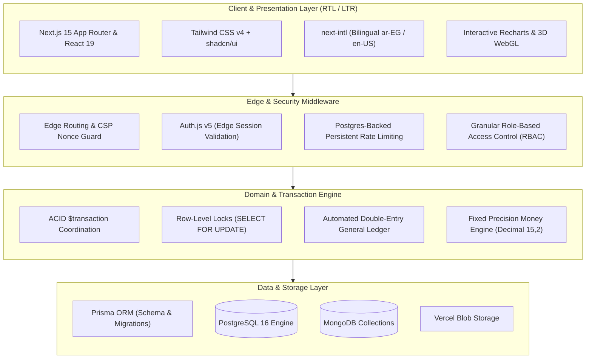

<div align="center">

<!-- Animated Header Wave Banner -->


<!-- Animated Typing SVG -->
<p align="center">
  <a href="https://github.com/ga5e8je99">
    
  </a>
</p>

<!-- Social & Portfolio Badges -->
<p align="center">
  <a href="https://gamal-iota.vercel.app"></a>
  <a href="https://linkedin.com/in/gamal-ahmed--"></a>
  <a href="mailto:gamal.ahmed.dev@gmail.com"></a>
  <a href="https://github.com/ga5e8je99"></a>
</p>

<br/>

```typescript
const gamalAhmed: SoftwareEngineer = {
  name: "Gamal Ahmed",
  role: "Lead Full-Stack Engineer & System Architect",
  location: "Cairo, Egypt",
  education: "B.Sc. in Computer Science & Informatics (2025)",
  focus: ["Enterprise ERP Systems", "ACID Transactions", "Concurrency Control", "3D WebGL & AI"],
  stack: ["Next.js 15", "React 19", "TypeScript", "Prisma ORM", "PostgreSQL", "Node.js", "Tailwind CSS"],
  status: "Open to High-Impact Full-Time Engineering Roles & Enterprise Contracts"
};
```

</div>

---

## 🛠️ Animated Tech Stack & Tools

<div align="center">

<p align="center">
  <a href="https://skillicons.dev">
    
  </a>
</p>

</div>

---

## 🏛️ System Architecture & Engineering Blueprint

As a full-stack engineer, I design applications around **data consistency, transactional integrity (ACID), zero race conditions**, and smooth, responsive UI/UX across RTL and LTR locales:



---

## 🚀 Flagship Projects

<table>
  <thead>
    <tr>
      <th width="30%">Project</th>
      <th width="45%">Architecture & Technical Highlights</th>
      <th width="25%">Links & Live Demos</th>
    </tr>
  </thead>
  <tbody>
    <tr>
      <td>
        <b>🏢 Masar ERP (مسار)</b><br/>
        <sub>Enterprise Resource Planning & Financial System</sub>
      </td>
      <td>
        • <b>Next.js 15 App Router + React 19 + TypeScript + Prisma ORM + PostgreSQL</b><br/>
        • Full double-entry financial accounting with automated general ledger posting.<br/>
        • Multi-warehouse inventory with <code>SELECT FOR UPDATE</code> row-level concurrency locks.<br/>
        • Edge-compatible Auth.js v5, DB-backed rate limiting, and bilingual RTL/LTR dashboards.
      </td>
      <td>
        <a href="https://erp-system-one-alpha.vercel.app"><b>🌐 Live Application</b></a><br/>
        <a href="https://github.com/ga5e8je99/erp-system"><b>💻 Source Code</b></a>
      </td>
    </tr>
    <tr>
      <td>
        <b>🌍 Sky – 3D Weather Globe</b><br/>
        <sub>Interactive Atmospheric Telemetry Platform</sub>
      </td>
      <td>
        • <b>React + Three.js + WebGL + Tailwind CSS + OpenWeather API</b><br/>
        • Real-time 3D interactive globe with day/night terminator lighting at 60 FPS.<br/>
        • Geographic latitude/longitude to 3D sphere coordinate vector projection.<br/>
        • Granular 7-day predictive forecasts, UV tracking, wind velocity & humidity metrics.
      </td>
      <td>
        <a href="https://sky-five-sage.vercel.app"><b>🌐 Live Application</b></a><br/>
        <a href="https://github.com/ga5e8je99/sky"><b>💻 Source Code</b></a>
      </td>
    </tr>
    <tr>
      <td>
        <b>🤖 JobMatch AI</b><br/>
        <sub>Smart ATS Resume Analyzer & Builder</sub>
      </td>
      <td>
        • <b>Next.js 15 + TypeScript + Tailwind CSS + Framer Motion</b><br/>
        • Real-time ATS parser evaluating keyword density, formatting, and structural compliance.<br/>
        • Missing keyword extraction matrix mapped against target job descriptions.<br/>
        • Clean single-column ISO A4 machine-readable PDF resume export.
      </td>
      <td>
        <a href="https://ai-resume-lilac-seven.vercel.app"><b>🌐 Live Application</b></a><br/>
        <a href="https://github.com/ga5e8je99/AI-Resume"><b>💻 Source Code</b></a>
      </td>
    </tr>
    <tr>
      <td>
        <b>🍕 PizzaHouse Delivery</b><br/>
        <sub>E-Commerce Food Ordering Platform</sub>
      </td>
      <td>
        • <b>React + Redux Toolkit + Node.js + Express + MongoDB</b><br/>
        • Interactive stone-baked pizza customizer with dynamic multi-topping calculations.<br/>
        • Persistent Redux Toolkit cart state with promo-code validation and delivery math.<br/>
        • Responsive mobile-first interface with sub-second cart updates.
      </td>
      <td>
        <a href="https://pizza-delivery-app.vercel.app"><b>🌐 Live Application</b></a><br/>
        <a href="https://github.com/ga5e8je99/pizza-lab"><b>💻 Source Code</b></a>
      </td>
    </tr>
    <tr>
      <td>
        <b>📚 BookStore</b><br/>
        <sub>Curated Digital Reading & Book E-Commerce</sub>
      </td>
      <td>
        • <b>Next.js + Node.js + Express + MongoDB (MVC Architecture)</b><br/>
        • High-speed multi-criteria catalog search across 15,000+ curated literature titles.<br/>
        • Secure JWT authentication, quick preview modal spotlight, and encrypted checkout.
      </td>
      <td>
        <a href="https://dashboard-mu-ochre-23.vercel.app"><b>🌐 Live Application</b></a><br/>
        <a href="https://github.com/ga5e8je99/book-store"><b>💻 Source Code</b></a>
      </td>
    </tr>
    <tr>
      <td>
        <b>💬 NeoChat</b><br/>
        <sub>Multimodal AI Assistant & Visual Studio</sub>
      </td>
      <td>
        • <b>React 19 + Material-UI (MUI v7) + Google Gemini 2.5 + FLUX AI</b><br/>
        • Multimodal visual image reasoning via drag-and-drop & clipboard paste.<br/>
        • High-resolution AI artwork synthesis with FLUX and live Web Speech voice dictation.
      </td>
      <td>
        <a href="https://neo-pi-six.vercel.app"><b>🌐 Live Application</b></a><br/>
        <a href="https://github.com/ga5e8je99/neo"><b>💻 Source Code</b></a>
      </td>
    </tr>
  </tbody>
</table>

---

## 🐍 Contribution Graph & Activity

<div align="center">

<!-- Animated Contribution Snake -->
<picture>
  <source media="(prefers-color-scheme: dark)" srcset="https://raw.githubusercontent.com/ga5e8je99/ga5e8je99/output/github-contribution-grid-snake-dark.svg">
  <source media="(prefers-color-scheme: light)" srcset="https://raw.githubusercontent.com/ga5e8je99/ga5e8je99/output/github-contribution-grid-snake.svg">
  
</picture>

<br/>

<!-- Animated Activity Graph -->


<br/>

<!-- GitHub Analytics Cards with Fire Animation -->


<br/>


</div>

---

<!-- Animated Footer Wave Banner -->


<div align="center">
  <b>Let's build something exceptional together!</b><br/>
  💼 Available for Full-Time & Contract Roles • ✉️ <a href="mailto:gamal.ahmed.dev@gmail.com">gamal.ahmed.dev@gmail.com</a> • 🌐 <a href="https://gamal-iota.vercel.app">gamalahmed.dev</a>
</div>
